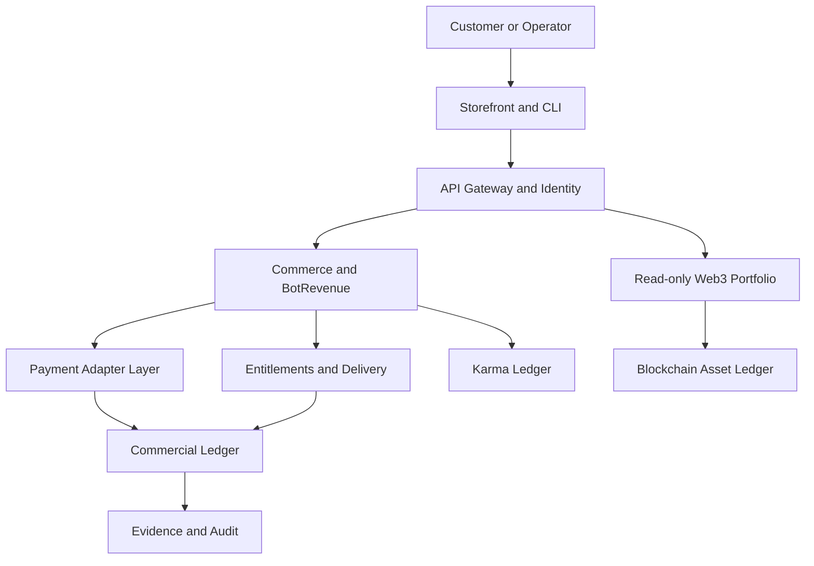

# MELODIESPARK INC — BOTREVENUE + WEB3 MASTER BUILD

Version: 1.0.0  
Authority model: evidence-first, fail-closed  
Canonical Windows target: `C:\MelodieCLI`  
Prepared for: Maxime Aubé / Melodie Max

## 1. Executive outcome

Build one enterprise platform that lets Melodiespark create, publish, sell, fulfill, and improve legitimate digital products and services. The platform combines a storefront, subscriptions, customer operations, BotRevenue workflow automation, a non-financial Karma reputation system, and a user-controlled Web3 portfolio.

The first production proof is deliberately narrow:

> One real product → one real customer → one captured payment → one delivered entitlement → one reconciled ledger record → one reproducible evidence package.

Everything beyond that proof remains `DEFINED`, `PLANNED`, or `BLOCKED` until its gate passes.

## 2. Non-negotiable operating contract

1. Never fabricate customers, orders, payments, revenue, balances, licenses, deployments, transaction hashes, or corporate authorization.
2. Commercial revenue requires a real customer, real product, captured payment, provider evidence, and audit record.
3. Commercial money, Karma/rewards, and blockchain assets use separate ledgers and dashboards.
4. Finance agents are read-only. Refunds, payouts, transfers, pricing changes, production releases, and token operations require scoped human approval.
5. Wallet operations use public addresses and an external signer. Never collect or store a seed phrase or private key.
6. Never overwrite `.env`; secrets remain in an approved secret manager or runtime environment.
7. Test and sandbox records are visibly labeled and excluded from live totals.
8. Missing evidence fails closed.

## 3. Truthful status baseline

| Area | Status supported by attachments | Release claim allowed |
|---|---|---|
| Enterprise vision and architecture | Defined | Yes: specification exists |
| PowerShell command-center design | Partially implemented in supplied text | Only after extraction and tests |
| Revenue invariant validator | Implemented as supplied code | Not verified in this environment |
| Audit-chain design | Implemented as supplied code | Not independently audited |
| PostgreSQL domain model | Defined | No connected production database proven |
| Storefront and checkout | Defined | Not released |
| Payment provider connection | Defined | No live provider proven |
| Verified commercial revenue | Unverified / zero in supplied dashboard | No revenue claim |
| Wallet and blockchain connectivity | Defined | Read-only concept only |
| MA Token | Conceptual | No issuance, value, swap, or yield claim |
| Cloud deployment | Defined | No production deployment proven |
| Corporate licensing/authorization | Requires external evidence | Never infer from documents |

## 4. Seven-layer construction matrix

| Layer | Engineering domain | Required deliverable | Exit evidence |
|---|---|---|---|
| Alpha | Identity and foundation | Git, configuration, IAM, RBAC, tenant isolation | Tests, policy checks, protected secrets |
| Beta | Products and commerce | Catalog, pricing, carts, checkout, payments, subscriptions | Provider test events and contract tests |
| Gamma | Data and evidence | PostgreSQL, ledgers, evidence store, hash-linked audit | Migrations, constraints, integrity tests |
| Delta | Integration and delivery | Webhooks, entitlements, licenses, downloads, customer portal | End-to-end fulfillment proof |
| Theta | Analytics and intelligence | Reconciliation, attribution, dashboards, accounting export | Totals traceable to source records |
| Bravo | Operations and resilience | CI/CD, queues, telemetry, backup, rollback, incident response | Restore drill and release evidence |
| Omega | Governance and compliance | Approvals, privacy, treasury policy, token gates, audit | Named authority and signed gate decision |

## 5. Reference architecture



No service may merge the three ledgers.

## 6. Target repository

```text
melodiespark-platform/
  apps/
    storefront/          # Next.js customer commerce
    control-center/      # Operations, evidence, approvals
    customer-portal/     # Orders, receipts, entitlements
    cli/                 # MelodieCLI operator interface
  services/
    identity/
    catalog/
    checkout/
    payments/
    subscriptions/
    entitlements/
    botrevenue/
    karma/
    wallet-read/
    reconciliation/
    audit/
    notifications/
  packages/
    contracts/
    database/
    events/
    security/
    provider-adapters/
    observability/
    ui/
  infra/
    docker/
    terraform/
    kubernetes/
    github-actions/
  docs/
    architecture/
    runbooks/
    compliance/
    evidence/
```

Start as a modular monolith plus background worker. Split services only when measured scaling, security, or ownership boundaries justify it.

## 7. Canonical domain model

Minimum PostgreSQL entities:

- `organizations`, `tenants`, `users`, `roles`, `permissions`, `sessions`
- `customers`, `customer_consents`, `addresses`
- `products`, `product_versions`, `prices`, `bundles`
- `carts`, `orders`, `order_items`, `invoices`
- `payments`, `payment_attempts`, `refunds`, `disputes`, `settlements`
- `subscriptions`, `subscription_events`
- `entitlements`, `deliveries`, `licenses`
- `commercial_ledger_entries`, `karma_ledger_entries`, `blockchain_asset_observations`
- `provider_events`, `evidence_records`, `audit_records`
- `approval_requests`, `approval_decisions`
- `campaigns`, `leads`, `attributions`
- `workflow_runs`, `workflow_steps`, `dead_letters`

Financial amounts use integer minor units plus ISO-4217 currency. Provider payloads are minimized, encrypted where required, hashed, and retained according to policy.

## 8. Pentagonal revenue gate

A record enters verified commercial revenue only when all five vertices pass:

| Vertex | Validation |
|---|---|
| Real customer | Non-test customer identity connected to the order |
| Real product | Active SKU and server-authoritative price |
| Captured payment | Official provider status is captured/paid/succeeded |
| Provider evidence | Verified webhook signature plus provider object ID and payload hash |
| Audit record | Append-only event with actor, timestamp, correlation ID, and previous hash |

Additional requirements: classification is `LIVE`, gross amount is positive, currency is valid, net arithmetic balances, and refunds/chargebacks create new adjustment entries rather than rewriting history.

## 9. Payment engine

Expose one internal interface for Stripe first, then add PayPal/Braintree, Square, Adyen, or Authorize.Net only when needed:

```text
createCustomer | createCheckout | authorize | capture | refund
getPayment | createSubscription | cancelSubscription
verifyWebhook | normalizeEvent | reconcileSettlement
```

Every mutation requires an idempotency key, correlation ID, tenant scope, authorization decision, validation, audit event, and safe retry policy. Declines, invalid requests, and fraud rejections are not retried automatically.

Payment state machine:

```text
initiated → pending → authorized → captured → settled
pending → failed
authorized → voided
captured → partially_refunded | refunded | disputed
disputed → won | lost
```

## 10. BotRevenue automation

BotRevenue automates work; it does not manufacture money.

| Agent | Permitted automation | Human gate |
|---|---|---|
| Product | Research, specifications, drafts, QA checklist | Publish and price |
| Marketing | SEO drafts, campaign plans, scheduling proposals | External publication and budget |
| Sales | Lead scoring, recommendations, follow-up drafts | Binding offers and discounts |
| Support | Triage, FAQ answers, case summaries | Refunds and sensitive disclosures |
| Revenue Ops | Read-only analytics and reconciliation proposals | Ledger corrections and payouts |
| Security | Scans, alerts, evidence collection | Policy exceptions |

## 11. Digital product packages

Launch with three evidence-ready offers:

| Package | Customer result | Deliverable | Commercial model |
|---|---|---|---|
| MelodieCLI Starter | Install and run a governed AI command center | Signed download, documentation, updates | One-time license |
| Phoenix Workflow Pack | Automate a defined business workflow | Versioned workflow, setup guide, support | One-time or subscription |
| BotRevenue Operations | Manage catalog, campaigns, evidence, and reporting | Hosted dashboard and approved automations | Monthly subscription |

Each SKU needs a definition of done, license, refund policy, support boundary, security statement, price, tax class, version, checksum, and delivery test.

## 12. Karma and Web3 model

Karma Power Points are reputation units, not cash, revenue, deposits, securities, or guaranteed cryptocurrency. A positive action produces only a pending claim until eligibility and evidence are reviewed. Rewards are funded and classified separately.

The Web3 portfolio initially supports read-only EIP-1193 wallet connection, chain verification, public-address balance lookup, token metadata validation, explorer links, and transaction history. Sending, swapping, bridging, staking, minting, or off-ramping is disabled until separate legal, security, treasury, and approval gates pass.

MA Token remains blocked until there is documented corporate authority, legal review, threat model, economic model, audited smart contract, deployment record, treasury controls, disclosure package, and jurisdiction policy. No guaranteed value, yield, conversion, or appreciation is permitted.

## 13. API and event contracts

Initial REST surface:

```text
GET  /health
GET  /v1/products
POST /v1/checkout-sessions
POST /v1/webhooks/stripe
GET  /v1/orders/{id}
GET  /v1/entitlements
GET  /v1/revenue/summary
GET  /v1/reconciliation/exceptions
GET  /v1/karma/balance
GET  /v1/wallets/{address}/portfolio
POST /v1/approvals
POST /v1/approvals/{id}/decisions
```

Core events: `CustomerCreated`, `ProductPublished`, `OrderCreated`, `PaymentCaptured`, `PaymentFailed`, `PaymentRefunded`, `DisputeOpened`, `EntitlementGranted`, `DeliveryCompleted`, `RevenueVerified`, `RevenueExcluded`, `KarmaClaimSubmitted`, `KarmaAwarded`, `WalletObservationRecorded`, `ApprovalRequested`, and `AuditIntegrityFailed`.

## 14. Security and privacy baseline

- OAuth/OIDC authentication, MFA for privileged roles, deny-first RBAC.
- Tenant ID enforced at API, service, query, and audit boundaries.
- TLS in transit, encryption at rest, secret rotation, log redaction.
- Signed webhook verification before queueing; replay and duplicate protection.
- CSP, CSRF defense, input schemas, output encoding, rate limits, dependency scanning.
- Québec Law 25 privacy assessment, consent records, access/correction/export/deletion workflows, retention schedule, and incident procedure.
- PCI scope minimized through hosted provider checkout and tokenization.

## 15. Delivery plan

### Phase 0 — Truth baseline

Inventory `C:\MelodieCLI`, preserve existing changes and `.env`, confirm repository root, run secret scan, and generate an evidence manifest. Exit: authoritative workspace census.

### Phase 1 — Golden-path foundation

PostgreSQL migrations, identity, catalog, one product, Stripe test checkout, signed webhook, order, evidence, commercial ledger, entitlement, receipt. Exit: reproducible test purchase.

### Phase 2 — Verified production sale

Complete legal/merchant configuration, production secrets, monitoring, backups, refund path, support runbook, and controlled deployment. Exit: one approved live product and one reconciled payment.

### Phase 3 — BotRevenue

Add leads, campaigns, attribution, product workflows, job queue, dead letters, approval gates, and read-only analytics. Exit: measurable automation without unsupervised financial mutation.

### Phase 4 — Subscriptions and marketplace

Subscription lifecycle, creator onboarding, revenue share, tax, payouts, disputes, and settlement reconciliation. Exit: audited multi-party accounting.

### Phase 5 — Karma and wallet

Verified contribution workflow, non-financial rewards, read-only wallet portfolio, chain allowlist, RPC evidence. Exit: three-economy separation tests pass.

### Phase 6 — Token decision

Legal/security/economic review produces a go, revise, or no-go decision. Token implementation begins only after an explicit go.

## 16. Release gates

| Level | Meaning | Required proof |
|---|---|---|
| Defined | Specification exists | Reviewed document and owner |
| Implemented | Code runs locally | Build output and commit |
| Tested | Automated tests pass | Test report |
| Verified | End-to-end behavior proven | Reproduction steps and evidence |
| Audited | Independent review completed | Findings and disposition |
| Released | Controlled deployment completed | Release manifest and rollback |
| Operational | Production behavior is monitored | SLO evidence and incident readiness |

No “Omega,” “Infinity,” “Revolutionary,” “licensed,” “authorized,” or “fully operational” status overrides this ladder.

## 17. First sprint backlog

1. Resolve the true Git monorepo root under `C:\MelodieCLI`.
2. Preserve user files and run a deny-first secret scan.
3. Extract the supplied PowerShell command center into its own `.ps1` file.
4. Fix and run its parser and self-tests under PowerShell 7.
5. Validate the PostgreSQL migration and rollback against a fresh database.
6. Implement domain contracts for customer, product, order, payment, evidence, and entitlement.
7. Add Stripe test adapter and signed webhook verification.
8. Add idempotent payment state transitions and commercial ledger posting.
9. Deliver a signed or expiring entitlement after verified capture.
10. Generate a reconciliation and evidence report for the test purchase.

## 18. Definition of total activation

“Activated BotRevenue” means the system is deployed, monitored, and capable of selling an approved product to a real customer through an official payment provider, delivering the purchased entitlement, recording balanced and immutable financial entries, reconciling the provider settlement, and producing an evidence package. It never means automatic guaranteed income, invented balances, or autonomous movement of funds.

This document is the consolidated build authority. The two source attachments remain reference material; contradictory status claims are governed by the evidence ladder above.
