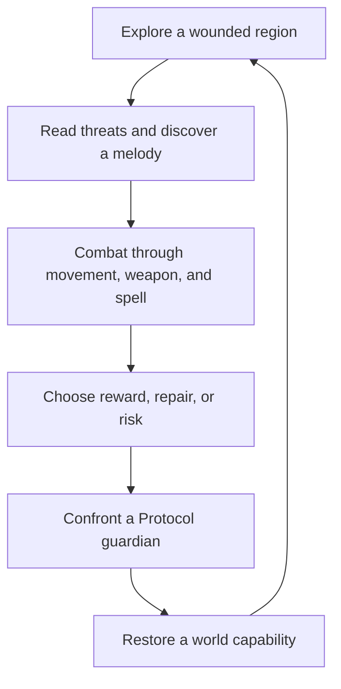
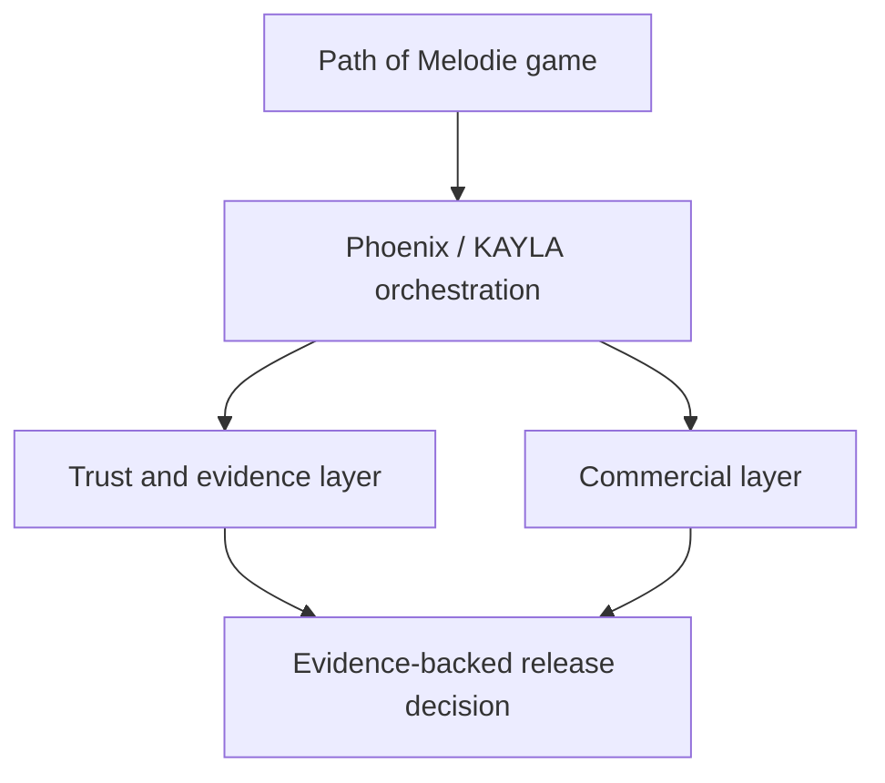

# Path of Melodie: Maakaras Protocols
## Melodiespark Inc. — Unified A–Z Game, Platform, and Release Blueprint

**Document purpose.** This is the operating blueprint for the first flagship proof of Melodiespark Inc.: a memorable dark-fantasy action RPG that also proves the company can operate a trustworthy, repeatable product factory. It is a design authority and planning document, not a claim that unverified game, financial, or release features are complete.

**North Star:** *One unforgettable heroine. One unmistakable combat melody. One verified playable journey from Genesis Refuge to the first broken Protocol.*

---

## 1. Executive identity

| Dimension | Decision |
|---|---|
| Product | Premium-feeling isometric action RPG, **Path of Melodie: Maakaras Protocols** |
| Company | **Melodiespark Inc.**, building an AI-native product-factory operating system |
| Player fantasy | Become a Resonant: shape music into lethal movement, spells, protection, and renewal; expose the corrupted Protocols controlling a wounded world |
| Visual signature | Dark-gothic stylized readability: obsidian, crimson, violet, molten gold, electric cyan; painterly materials and strong silhouettes |
| Gameplay signature | Tight dodge-and-strike combat where rhythm is expressive, never a mandatory timing minigame |
| First vertical-slice promise | Genesis Refuge → one combat route → one meaningful choice → one dungeon → first Maakara Protocol boss → verified completion record |
| Platform proof | One customer can purchase, receive the product, run a safe first-time flow, and produce an auditable `FIRSTRUNCOMPLETED` outcome |

The game is not a technology demo and the platform is not an excuse to bury the game in infrastructure. The game earns attention through emotion, movement, combat clarity, bosses, art direction, and a visible authorial voice. Melodiespark earns trust by making its build, evidence, access, commerce, and operational decisions explicit.

---

## 2. Player-facing pitch

The world once sang in a single living harmony. The **Maakara Protocols** were created to preserve that harmony: enormous systems of order that governed memory, growth, passage, conflict, and renewal. Their creators disappeared. The Protocols continued, interpreting preservation as control.

Melodie, a young Resonant whose voice can awaken lost tonal paths, reaches the **Genesis Refuge**, the final sanctuary outside protocol authority. When the Refuge's protective anthem fractures, she learns that every reclaimed melody is both a weapon and a question: repair the world’s systems, replace them, or teach people to live without them.

This is a story about power with consent. A player can become stronger without becoming another unaccountable Protocol.

### Experience pillars

1. **Resonant action.** Every tool has a physical combat identity before it has a musical explanation: a dash cuts distance, a chord detonates space, a refrain protects an ally.
2. **Legible darkness.** Enemies, hazards, loot, paths, objectives, and player effects remain readable even within gothic spectacle.
3. **Earned ascension.** Mastery comes from encounter knowledge, build expression, and accountable progression—not repetitive grinding alone.
4. **A haunted living world.** Each zone communicates what its Protocol controlled and the human cost of that control.
5. **Trust by design.** No hidden financial automation, no invented evidence, no claims of scarcity or value that lack real implementation and disclosure.

---

## 3. Canonical game loop

At minute-to-minute scale the loop is: see → position → commit → evade → resolve → collect → tune the build. At session scale it is: travel → discover a local wound → meet affected characters → gain a new Resonance → clear a landmark → make a consequence-bearing decision → return to a changed hub.

### Combat cadence

| Beat | Player action | Required feel |
|---|---|---|
| Read | Identify enemy intent, arena geometry, beat window | Clear, fair, learnable |
| Commit | Weapon chain, spell phrase, or traversal move | Responsive and decisive |
| Counterpoint | Dodge, parry/guard, interrupt, reposition | Skilled, not punitive |
| Crescendo | Spend Resonance for high-impact signature action | Spectacular but controlled |
| Resolution | Secure loot, save ally, open route, alter encounter | A visible consequence |

Rhythm must support the fantasy but never exclude players. Audio cues, VFX pulses, animation timing, optional accessibility indicators, and generous input buffering make the system readable. A player can succeed by observation and action skill without playing to a metronome.

---

## 4. World, acts, and Protocols

| Act | Region | Broken Protocol | Emotional function | Major reward |
|---|---|---|---|---|
| I | Genesis Refuge | **Awakening** | Safety is fragile; the first song returns | Core movement + first Resonance |
| II | Cinder Choir | **Conflict** | Survival cultures weaponized an old safeguard | Weapon specialization |
| III | Glassroot Expanse | **Growth** | Life optimized beyond mercy | Companion/construct system |
| IV | Cathedral of Echoes | **Memory** | History controlled through edited remembrance | Truth/choice quest system |
| V | Tidemark Necropolis | **Passage** | Death, travel, and trade halted by perfect bureaucracy | Advanced traversal + world routes |
| VI | Maakara Spire | **Continuity** | The system’s final argument: order over agency | Endgame authority and final choice |

Each region requires a distinct combat grammar, not just a new color palette. Cinder Choir uses collapsing cover and heat lanes; Glassroot Expanse uses living hazards and growth bursts; Cathedral of Echoes revises pathways through memories; Tidemark has tide cycles and ghost traffic; Maakara Spire recombines learned mechanics.

### Factions

- **Resonants:** people able to perceive and shape fragments of the original harmony. Diverse, fallible, not automatically heroic.
- **Refuge Council:** protectors of Genesis who may confuse safety with stagnation.
- **The Cantors of Ash:** survivors who use Protocol debris as instruments of resistance.
- **Rootbound:** communities adapted to the Glassroot ecosystem; they oppose both exploitation and careless restoration.
- **Archivists Unwritten:** memory keepers who preserve records the Protocol erased.
- **Protocol Adherents:** people who genuinely prefer predictable rule after surviving collapse; they are ideological opponents, not disposable villains.

---

## 5. Hero, weapons, and buildcraft

Melodie is defined by agency, resilience, curiosity, and a recognisable silhouette. Her character arc begins with inherited responsibility and develops toward informed leadership: she does not merely defeat systems, she learns how to build accountable alternatives.

### Launch weapon trio

| Weapon | Role | Combat language | Musical identity |
|---|---|---|---|
| Resonant Blade | Balanced duelist | chaining strikes, precise counters, gap closing | sharp lead melody |
| Chorus Bow | Range and control | aimed shots, volleys, delayed detonations | layered harmony |
| Cinder Lute-Staff | Area control/support | zones, knockback, shields, charged bursts | bass pulse and refrain |

### Resonance schools

1. **Pulse** — speed, shock, interruption, electricity.
2. **Refrain** — shields, echoes, healing/support effects, recurrence.
3. **Dirge** — damage-over-time, fear, decay, sacrifice mechanics.
4. **Crescendo** — burst, crowd control, amplification, high-risk payoff.
5. **Harmonic** — hybridization, resonance conversion, party/companion synergy.

Every build selects: one weapon identity, one movement modifier, three active phrases, three passive motifs, and one ultimate composition. Limits are intentional. They make choices understandable, balanceable, and visually readable.

### Item philosophy

Items should change decisions, not inflate irrelevant numbers. Common items teach a modifier; rare items form a build direction; legendary items bend a rule; unique artifacts tell a story and have a clear tradeoff. Tooltips must state what changes, where it applies, and how the player can see it in play.

---

## 6. Enemies and bosses

### Enemy families

| Family | Function | Readability rule |
|---|---|---|
| Protocol Sentinels | baseline melee/range/defense | one unmistakable silhouette per threat |
| Choir Aberrants | tempo manipulation and swarms | audio cue always paired with visual cue |
| Rootborn | terrain growth and ambush | hazards telegraph before damage |
| Memory Shades | misdirection and duplication | the real target remains identifiable |
| Tidemark Revenants | movement denial and repositioning | arena state clearly predicts tide shift |

### Maakara boss architecture

Every boss is a protocol made physical: a readable thesis, three escalating variations, an arena that teaches the rule, and a final counterplay test. Bosses do not simply become faster. They recombine mechanics the player has learned.

**First broken Protocol: Maakara Gamma, the Warden of Awakening.** Gamma periodically locks parts of the arena into repeating motifs. The player breaks the loop by moving through safe tonal nodes, interrupting a charged phrase, then using the gained Resonance to expose the core. The fight proves the game’s central idea: listen, move, answer, transform.

Boss standards:

- A first clear must be possible without perfect timing or a meta build.
- Failure teaches one actionable lesson.
- Phase transitions never obscure a lethal player state.
- Damage, invulnerability, and break windows use consistent language.
- Reward includes a build option, narrative consequence, and world-state change.

---

## 7. Progression, Karma Ascension, and economy boundaries

The game has three deliberately separate concepts:

| System | Meaning | Source | Non-negotiable boundary |
|---|---|---|---|
| Character power | Combat capability and unlocks | gameplay progression | balanced inside the game |
| KPP | earned effort/protocol participation metric | verified gameplay events | never granted client-side as an authoritative fact |
| Karma Ascension | visible rank and recognition | validated KPP and achievement criteria | must resist farming and botting |
| Genesis Artifacts | legendary collectible/achievement class | scarce authored criteria | any hard cap must be real, auditable, and disclosed |
| Commercial value | purchase, DLC, cosmetics, services | explicit customer transaction | never represented as fabricated revenue |

The client may emit an event such as `Event.Combat.BossDefeated` with a boss identifier, player identity, duration, and flawless flag. It must not authoritatively award KPP on its own. A trusted server-side workflow validates the event, checks abuse controls, records evidence, and only then updates progression. Any future external ledger, mint, or transfer capability remains separate from standard gameplay and must preserve the existing read-only, external-signer, explicit-approval treasury policy.

### Anti-exploitation design

- Reward encounter variety, difficulty, completion quality, and contribution—not raw repetition.
- Put server authority over rank-affecting events.
- Rate-limit suspicious patterns and retain explainable audit records.
- Never market unimplemented token, trading, yield, or revenue features.
- Keep competitive integrity separate from cosmetic or supporter monetization.

---

## 8. Art, UX, audio, and accessibility authority

### Art direction

The world is a collision between cathedral-gothic monumentality and musical energy. Stone is worn, faceted, and readable. Metal catches molten gold. Corruption uses violet-black veins and electric cyan error-light. Crimson marks danger, loss, and decisive offense; it should not be the only danger signal.

The camera is isometric with controlled zoom zones for bosses and landmarks. Characters have strong top-down silhouettes. Player attacks use a colour/value hierarchy distinct from enemy danger, interactables, loot, and friendly effects. The GTX 1050 2 GB class is a baseline performance target for the slice: scalable particles, texture budgets, LODs, and effects priorities are part of art direction from day one.

### Audio direction

Music is reactive, not merely background. Regions have tonal identities; combat adds stems as danger grows; player phrases return short motifs; boss mechanics announce themselves through sound without requiring perfect pitch. Sound settings include independent music, effects, dialogue, dynamic-range, and visual rhythm-cue controls.

### Accessibility minimums

- Full remapping and controller support.
- Subtitle speaker labels, scalable text, contrast-safe UI, and colour-independent markers.
- Adjustable camera shake, flash intensity, hit-stop, and rhythm-cue display.
- Difficulty options that preserve the full narrative and core systems.
- No essential information conveyed by audio alone.

---

## 9. Technical game architecture

**Engine target:** Unreal Engine 5.8. The canonical project is `C:\MelodieCLI\PathOfMelodie` with the editor at `D:\UE_5.8`. Treat the project tree as user work: inspect before edit; preserve assets, secrets, and unrelated changes.

| Layer | Responsibility |
|---|---|
| Presentation | camera, HUD, animation, VFX, audio, localization, accessibility |
| Gameplay framework | character state, abilities, combat resolution, AI, quests, saves |
| Content/data | versioned data assets for enemies, skills, items, encounters, dialogue, zones |
| Runtime services | account/session integration where required; graceful offline boundaries |
| Build/release | deterministic build configuration, cook, stage, package, signing/distribution evidence |
| Observability | crash reports, performance telemetry with privacy boundaries, gameplay diagnostics |

### Unreal implementation principles

- Data-driven definitions, code-driven rules; avoid content logic hidden in blueprints with no validation path.
- One canonical naming, folder, module, and asset-validation policy.
- Small test maps for combat, traversal, boss mechanics, performance, and save/load.
- Build every feature with a fallback for failed service calls or unavailable external integrations.
- Profile on the target hardware class before artistic complexity becomes irreversible.

### Content factory rule

The 30,000 authoring briefs are a planning inventory, not 30,000 finished assets. Asset count never substitutes for gameplay quality, legal provenance, import validation, performance budgets, or a verified packaged build. Content moves through: brief → source/provenance → review → import → technical validation → in-game placement → performance check → release evidence.

---

## 10. Melodiespark Inc. platform map

| Melodiespark layer | Role for this game | Guardrail |
|---|---|---|
| Phoenix Core / Kernel | coordinates repeatable engineering workflows | does not convert a failed gate into a pass |
| KAYLA Orchestrator | routes agents, jobs, approvals, and evidence | human decision remains explicit at material boundaries |
| MelodieCLI | operator entry point and reproducible commands | commands must emit usable evidence |
| MERA / Trust / Legal Nexus | evidence ledger, identity, policy, RBAC, auditability | evidence labels distinguish verified, unverified, blocked |
| Event Infrastructure / NATS | reliable internal event flow | gameplay reward events require validation and idempotency |
| LiteLLM Gateway | controlled model/tool routing for internal workflows | no secret leakage; tool permissions are minimal |
| BotRevenue / Stripe | purchase and customer lifecycle | no fake revenue or automatic fund movement |
| Treasury | read-only chain visibility where relevant | external signer, approval, no auto-transfer/broadcast |
| Phoenix Builder / Studio | creator and product-factory tools | never obscures authorship or provenance |
| Command Center | operational view of status and failures | shows uncertainty rather than cosmetic green checks |

### Golden Path

`Customer purchase → authorized fulfilment → repository/download entitlement → one safe launch command → app/game opens → first-run checks → FIRSTRUNCOMPLETED evidence`

The Golden Path needs a real test customer and a real controlled run before it can be called verified. It is not satisfied by configuration files or an attractive dashboard.

---

## 11. Governance and evidence protocol

Every important statement belongs in one of four states:

| State | Meaning | Example |
|---|---|---|
| VERIFIED | direct command, artifact, test, or independent check supports the claim | Editor C++ build passed with retained evidence |
| IMPLEMENTED, UNVERIFIED | code/config exists, but its required real-world outcome was not proven | an entitlement flow exists but no controlled purchase has completed |
| INCONCLUSIVE | evidence is incomplete, ambiguous, or capture failed | GDevelop preview exists but capture evidence is missing |
| BLOCKED / FAILED | a dependency or test prevents progression | cook/stage/package lacks passing evidence |

Current known release posture must remain honest: the UE editor C++ build and automation tests have been verified; runtime smoke has failed; cook and stage remain failed or incomplete; package is failed; GDevelop capture is inconclusive. Therefore R03, Maakara Prime, package, runtime, and release claims remain locked until their respective gates pass. A release candidate is not created by declaring the gates open.

### Release evidence bundle

- source revision and dependency lock state;
- editor build log and test results;
- cook, stage, package, and runtime smoke artifacts;
- build machine and hardware profile;
- asset provenance/validation report;
- vulnerability and secret-scan result;
- installer/hash/manifest verification;
- Golden Path transaction-and-first-run proof, using test-mode data until real commercial launch;
- unresolved-risk register with owner, decision, and expiry.

---

## 12. A–Z execution index

| Letter | Delivery authority | Definition of done |
|---|---|---|
| A | **Acquire baseline** | inventory, repo state, tool versions, hardware profile, evidence directory retained |
| B | **Back up safely** | version-control checkpoint; no credentials or generated bloat committed |
| C | **Confirm dependencies** | UE, compiler, SDK, package manager, plugins tested—not just detected |
| D | **Define the Genesis slice** | one heroine, weapon trio, spell set, dungeon, boss, completion objective locked |
| E | **Establish evidence** | gates, owners, commands, artifact locations, and fail criteria defined |
| F | **Forge core movement/combat** | input, camera, dodge, primary attack, damage, death, feedback feel correct |
| G | **Grow gameplay abilities** | three weapon identities and first Resonance choices playable and balance-tested |
| H | **Harden project configuration** | canonical modules, targets, plugins, build settings, asset rules, and no duplicate ambiguity |
| I | **Implement enemies and AI** | baseline enemy families, encounters, and test maps support real play |
| J | **Join narrative to play** | quests, dialogue, choices, boss progression, and world state visibly connect |
| K | **Karma Ascension boundary** | server-validated event model, anti-abuse design, and commercial separation documented |
| L | **Light, look, and listen** | art bible, VFX hierarchy, audio stems, readability tests, target performance budget |
| M | **Make Maakara Gamma** | complete first boss with fair telegraphs, phase tests, rewards, and narrative impact |
| N | **Normalize content pipeline** | provenance, naming, import, validation, placement, and performance workflow used on real content |
| O | **Optimize target hardware** | representative slice runs acceptably on GTX 1050/2 GB baseline and tracked hardware |
| P | **Prove persistence** | save/load, progression, failure recovery, and user-data policy tested |
| Q | **Quality assurance** | functional, regression, accessibility, performance, and content test suites run and retained |
| R | **Release candidate assembly** | cook, stage, package, install, runtime smoke, and rollback path pass with artifacts |
| S | **Secure services** | least privilege, secret protection, RBAC, service health, incident/runbook evidence |
| T | **Test the Golden Path** | purchase through first run is rehearsed end-to-end with truthful status |
| U | **User research** | observed players validate onboarding, combat readability, first boss, and delight |
| V | **Verify claims** | marketing, roadmap, economy, and technical assertions map to current evidence |
| W | **World production** | act-by-act content is created only after slice quality and pipeline capacity are proven |
| X | **Experience accessibility** | settings and acceptance checks prove players are not excluded by visual/audio/motor assumptions |
| Y | **Yield operations** | launch monitoring, support triage, crash response, and post-launch cadence ready |
| Z | **Zero-ambiguity launch decision** | launch, delay, or scoped pilot chosen from evidence; no greenwashing |

---

## 13. Phased roadmap

### Phase 0 — Truth and stabilization

Goal: establish the actual build and release state. Priorities: resolve cook/stage/package/runtimes in order; preserve logs; eliminate configuration ambiguity; avoid adding systems that cannot yet be validated. Exit: a reproducible editor build, automated checks, runtime smoke, cook, stage, and package have distinct, evidence-backed outcomes.

### Phase 1 — Genesis prototype

Goal: prove the game feels special before scale. Build the Genesis Refuge, one route, a training encounter, one enemy family, Blade/Bow/Lute-Staff foundations, one Resonance per school candidate, first quest, and a greybox Maakara Gamma. Exit: fresh players can understand, enjoy, and finish a 15–30 minute loop.

### Phase 2 — Art authority and vertical slice

Goal: turn prototype truth into a market-facing promise. Add final-quality art standards to representative spaces, character, UI, effects, audio, boss, and trailer capture. Exit: a 45–90 minute slice plays on target hardware with clear identity and tracked performance.

### Phase 3 — Systems depth

Goal: make repeat play meaningful. Add buildcraft, encounter variants, quest consequences, save integrity, tuning tools, and controlled Karma progression. Exit: a player can make distinct viable builds and explain why choices matter.

### Phase 4 — Content production

Goal: scale only a proven pipeline. Produce regions, bosses, quests, characters, items, audio, localization, and accessibility passes using the content factory workflow. Exit: each act meets content, performance, provenance, and playtest criteria.

### Phase 5 — Release candidate and Golden Path

Goal: prove the product can be delivered and supported. Rehearse installer, entitlement, first run, updates, telemetry, support, rollback, and evidence review. Exit: all gates are independently passable and the launch decision is defensible.

---

## 14. Immediate priority board

| Priority | Next result | Why it comes first |
|---|---|---|
| P0 | Resolve and evidence UE cook → stage → package → runtime smoke | no release claim can be trusted until the executable path works |
| P1 | Lock the Genesis vertical-slice contract | prevents 30,000 briefs from becoming unfocused volume |
| P2 | Build/repair one playable combat test map | validates the core fantasy faster than broad architecture |
| P3 | Implement and test Maakara Gamma greybox | forces combat, telegraphs, audio, camera, UI, and rewards to work together |
| P4 | Establish art/audio/performance budgets on GTX 1050 baseline | keeps the visual promise feasible on current target hardware |
| P5 | Validate save/progression and event authority | protects player trust before social/economic systems expand |
| P6 | Rehearse the Melodiespark Golden Path in test mode | makes the platform’s customer promise measurable |

### Work that can wait

- Large-scale asset import solely to reach a count target.
- Externalized scarcity, collectible minting, transfers, or treasury activity.
- Full-act production before the Genesis slice delights observed players.
- Marketing claims that imply packaging, customer payment, or runtime verification not yet evidenced.
- Complex multi-agent automation that does not reduce a currently measured build, test, or release risk.

---

## 15. Success scorecard

| Area | Evidence-backed success metric |
|---|---|
| Fun | new players complete the Genesis slice and can describe its combat melody and first boss lesson |
| Readability | usability checks show players distinguish threat, safe zone, objective, loot, and ally effects |
| Performance | accepted frame-time and memory budgets on GTX 1050-class reference hardware |
| Build health | repeatable build, cook, stage, package, install, launch, and smoke results |
| Trust | every public completion claim has a current evidence reference; unresolved claims are labeled |
| Commerce | one controlled purchase/fulfilment/first-run path produces factual audit evidence |
| Operations | support, rollback, crash triage, and incident ownership rehearsed |
| Creative integrity | world, combat, art, sound, and story reinforce a single unmistakable identity |

## Closing directive

Path of Melodie should become the first proof that Melodiespark can make a game with both soul and operational discipline. The immediate mission is not “build everything.” It is to prove one remarkable, runnable, measurable journey—then scale what has earned the right to scale.
