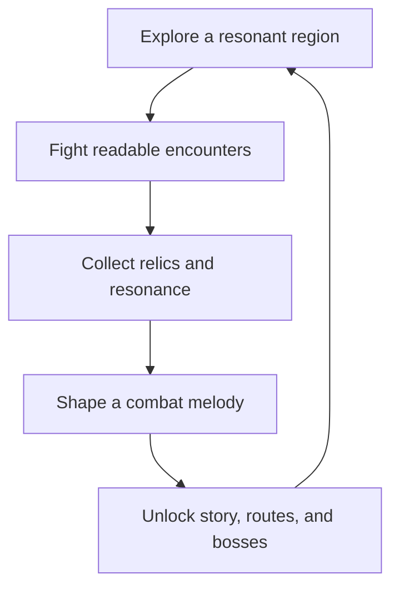

# Path of Melodie: Maakaras Protocols
## Original Isometric Action RPG — Unified Design Blueprint

**Owner:** Melodiespark Inc.  
**Format:** Original 3D/2D hybrid isometric action RPG  
**Target:** Windows PC; low-end profile for i5-6500 / GTX 1050 2 GB / 16 GB RAM  
**North star:** Musical spellcasting, readable high-stakes combat, an original dark-fantasy world, and a buildcraft journey that is deep without demanding spreadsheet study to enjoy.

> This blueprint draws high-level lessons from the ARPG genre. It does not copy characters, items, lore, maps, quests, art, code, names, UI, assets, or exact mechanics from Diablo, Path of Exile, Torchlight, or any other game.

---

## 1. The Game in One Sentence

In a world where broken cosmic music becomes living corruption, a melody-bonded Wanderer descends through the seven Maakara Protocols, turning rhythm, harmony, and dissonance into weapons to restore the Resonant World before the final silence consumes it.

## 2. The Player Promise

Every session delivers four feelings:

1. **Power with clarity:** attacks are spectacular but enemy telegraphs and player position stay legible.
2. **Expression:** the player assembles a personal combat melody rather than merely equipping bigger numbers.
3. **Discovery:** each zone exposes a new visual culture, enemy behavior, and musical rule.
4. **Forward motion:** every encounter feeds level growth, gear choice, story knowledge, or a meaningful unlock.

## 3. Original Design Pillars

| Pillar | Design rule | Player-facing result |
|---|---|---|
| Resonant Combat | Every active skill has a musical identity, readable timing, and a tactical role. | Casting feels like performing a dangerous battle composition. |
| Isometric Readability | Stable elevated camera, clean silhouettes, floor telegraphs, and limited visual clutter. | Deaths feel understandable; victories feel earned. |
| Friendly Buildcraft | Deep combinations are presented in layers: immediate, intermediate, expert. | New players can play; experts can optimize. |
| Hand-authored Adventure | Procedural variation supports authored regions, bosses, and story rather than replacing them. | The world has memorable places, not anonymous corridors. |
| Low-End Respect | Performance budgets are part of art and encounter design. | The game remains playable on modest hardware. |

## 4. Genre Lessons Reimagined as Original Systems

| Genre strength to learn from | Original Maakaras answer | Explicitly avoid |
|---|---|---|
| Dark action-RPG atmosphere and satisfying loot | **Resonance Relics:** equipment changes a skill's sound, geometry, cadence, and tactical function. | Copying named loot, visual sets, rarity language, or lore. |
| High build variety | **Chordcraft:** skills accept Motif, Pulse, and Echo modifiers, producing understandable combinations. | A giant inaccessible passive grid or copied skill-gem rules. |
| Fast, readable combat | **Protocol Windows:** bosses declare attack rhythms with visual and audio tells; players interrupt, dodge, or counter-harmonize. | Imitating enemy designs, bosses, or exact encounter patterns. |
| Warm character and companion charm | **The Resonance Caravan:** original supporting cast upgrades the hub, explains systems, and has personal quest arcs. | Cartoon mascot clones or existing companion archetypes. |
| Seasonal freshness | **Signal Fractures:** optional rotating challenge rooms with contained modifiers and no required FOMO. | Copying another game's league/season content structure. |

---

## 5. World, Tone, and Story

### The Resonant World

Creation began as the First Chord, a living spectrum of frequencies that gave matter its memory. The ancient **Conductors** built seven Protocols to keep the spectrum in balance. When a Conductor tried to remove grief, fear, and discord from the song, the rejected emotions became the **Maakara**: self-learning patterns of corruption that feed on unfinished human feeling.

The player is a **Wanderer of the Last Refrain**, one of the rare people able to hear and shape raw resonance. The central conflict is not “destroy all darkness”; it is learning that dissonance has a place in music. The final threat is the **Null Canticle**, an absolute silence promising safety at the cost of choice, memory, and life.

### Tone

Dark-gothic danger with stylized cartoon clarity. Ruins feel ancient and costly, not merely dirty. Humor comes from human relationships and odd magical craft, never from undercutting tragedy. Violence is fantasy-stylized; the visual priority is readable action, not gore.

### Campaign Structure

| Act | Region | Protocol | Narrative question | Boss climax |
|---|---|---|---|---|
| I | Ashen Conservatory | Ember Protocol | What remains after a culture burns its own history? | The Cinder Maestro |
| II | Glasswater Choir | Tidal Protocol | Can memory be trusted when it can be replayed? | The Mirror Siren |
| III | Verdant Ossuary | Root Protocol | When does protection become control? | The Thorn Matriarch |
| IV | Thunder Reliquary | Storm Protocol | Is speed the same as freedom? | The Volt Cantor |
| V | Velvet Catacombs | Veil Protocol | What do people become when no one can see them? | The Faceless Duet |
| VI | Astral Foundry | Orbit Protocol | Can creation survive endless optimization? | The Star-Smith Engine |
| VII | The Silent Basilica | Null Protocol | Is a painless world worth the loss of song? | Maakara Prime |

Each act has: a hub chapter, 2–3 explorable combat regions, one story dungeon, one optional side site, a major boss, and a new Chordcraft capability.

---

## 6. Core Gameplay Loop

### Minute-to-minute

- Move with WASD/left stick; aim with mouse/right stick.
- Use a primary attack, two core skills, movement skill, defensive response, and ultimate.
- Read enemy wind-ups through silhouette, sound, floor pattern, and color.
- Build **Tempo** by committing to attacks; spend it on a strong finisher or defensive counter.
- Pick up compact, readable loot drops; large item piles are avoided.

### Thirty-minute loop

- Clear a region objective.
- Compare 2–4 meaningful gear choices.
- Upgrade or alter one skill's Motif/Pulse/Echo behavior.
- Return to the Caravan to unlock a crafting, companion, or story advance.

### Long-term loop

- Complete all seven Protocols.
- Build specialized loadouts for bosses, exploration, and challenge rooms.
- Pursue original Relic Sets, optional Protocol variants, and mastery challenges.

---

## 7. Combat: The Musical Language

### Resources

| Resource | Purpose | Rule |
|---|---|---|
| Vitality | Health | Damage, shielding, recovery, death state. |
| Resonance | Core casting resource | Regenerates; prevents unlimited spam. |
| Tempo | Earned combat momentum | Gained through engagement, spent on finishers/counters. |
| Dissonance | Risk meter | Rises from powerful choices and dangerous zones; enables rewards but intensifies threats. |

### Skill grammar

Every skill has three comprehensible slots:

- **Motif** — what the skill is: bolt, wave, ward, dash, summon, strike.
- **Pulse** — how it repeats: burst, sustain, ricochet, delayed beat, orbit, crescendo.
- **Echo** — what it leaves behind: burn, chill, vulnerability, healing chord, barrier, lure.

Example: *Cyan Bolt + Ricochet Pulse + Discord Echo* fires a chain spell that leaves short-lived destabilizing zones. The tooltip communicates damage, cost, target behavior, and one plain-language tactical sentence.

### Playable archetypes

| Archetype | Combat fantasy | Signature mechanic |
|---|---|---|
| Aria Warden | Mid-range conductor with barriers and bolts | Routes enemy attacks into counter-chords. |
| Cinder Drummer | Close-range bruiser | Builds Tempo by striking on beat; spends it in shockwave finales. |
| Veil Lutenist | Mobile trickster | Leaves echoes that repeat the prior skill from alternate positions. |
| Root Cantor | Control/support summoner | Plants resonant anchors that reshape arena space. |

Start the vertical slice with **Aria Warden** only. Expand archetypes after the shared combat foundation is verified.

### Enemy roles

- **Rusher:** closes distance, vulnerable during recovery.
- **Caster:** projects area denial and creates target-priority decisions.
- **Guard:** protects others until broken by positioning or a counter skill.
- **Harrier:** punishes stationary play but has low durability.
- **Conductor:** modifies the group and becomes a clear priority target.
- **Elite:** combines two roles, has one readable rule change, and drops a better reward.

No enemy attacks should be hidden under particles. A player who fails should be able to answer: “What hit me, where could I move, and what will I do next time?”

---

## 8. Boss Protocols

Every protocol boss follows a three-part musical encounter instead of a long health sponge:

1. **Theme:** learn the boss's core pattern.
2. **Variation:** the arena or timing changes, demanding a new response.
3. **Finale:** the player uses a learned mechanic to create a damage window.

### Maakara Prime — Final Boss Concept

- **Phase 1, Silence Learns:** Prime copies the player's last-used pattern at reduced strength; teaches spacing.
- **Phase 2, The Broken Orchestra:** floating arena fragments create lanes and safe zones; the player restores a three-note sequence through combat.
- **Phase 3, Last Refrain:** Prime offers the Null Canticle; the player chooses to hold, release, or counter the rhythm. The mechanical choice changes the ending epilogue, not the game's core conclusion.

Bosses need fixed collision, capped adds, simple materials, and carefully budgeted VFX so the GTX 1050 target remains stable.

---

## 9. Loot, Crafting, and Progression

### Item types

| Slot | What it changes |
|---|---|
| Instrument | Main skill behavior and cast identity |
| Mantle | Defense, mobility, visual silhouette |
| Sigils (2) | Passive combat rules and resistances |
| Resonance Ring (2) | Conditional bonuses and utility |
| Relic | Rare build-defining effect with a tradeoff |

### Rarity approach

Use original labels: **Clear, Attuned, Harmonic, Mythic, Genesis**. Each tier must increase decision quality, not only numbers. The UI always shows whether an item is an upgrade for the equipped build and why.

### Crafting

The **Resonance Bench** supports a narrow set of intentional actions:

- Re-tune one affix within a controlled range.
- Bind a Motif to a new Pulse or Echo.
- Fuse duplicate components into a chosen crafting currency.
- Preserve one favored attribute while changing another.

Avoid opaque gambling as the primary advancement route. High-risk crafting is optional and clearly labeled.

### Mastery

Progression has four layers: character level, skill mastery, gear choices, and Protocol mastery. The first 10 levels should visibly change play; advanced optimization begins only after the campaign foundation works.

---

## 10. The Resonance Caravan (Hub)

The Caravan is a moving refuge that changes after every act. It is compact to support low-end hardware and quick navigation.

| NPC | Function | Story role |
|---|---|---|
| Luma Vey | Skill and Chordcraft guide | Believes every problem has a correct pattern; learns to improvise. |
| Orrin Brass | Crafting | Repairs instruments while hiding an old Protocol injury. |
| Sable Kite | Scout and map route unlocks | Collects impossible stories and recognizes the truth behind the Null Canticle. |
| The Bellkeeper | Challenge and mastery gate | A damaged automaton that remembers prior worlds. |

No real-money economy is required for the vertical slice. Any future commerce must remain separate from gameplay power, transparently disclosed, and never claim unverified revenue.

---

## 11. Art Direction and Asset Families

### Visual signature

- **Palette:** obsidian black, crimson threat, violet mystery, molten gold sanctuary, electric cyan resonance.
- **Materials:** painterly stone, lacquered metals, crystal corruption, cloth with strong readable folds.
- **Camera:** high three-quarter isometric; player lives in lower-middle frame; attack zones remain readable.
- **VFX:** musical geometry, ribbons, rings, glyphs, and pulses—not generic particle fog.

### Asset production order

1. Player silhouette, rig, and four core animation states.
2. TestMap floor/walls/props plus one clean lighting setup.
3. Three enemies and one elite using reusable animation/material rules.
4. Primary attack, area skill, dash, shield/counter, enemy telegraphs.
5. HUD, pause/settings, item card, objective marker.
6. First boss and its arena kit.
7. Campaign-region kits after the runtime slice is verified.

Generated images are concept references. Production game assets require owned source files, topology, UVs, rigs, animation, collision, LODs, compression, and UE import validation.

---

## 12. UX, Accessibility, and Controls

- Remappable keyboard/mouse and controller bindings.
- High-contrast telegraphs option; color is never the only danger signal.
- Scalable text and subtitle options.
- Camera shake, flash, motion blur, and screen distortion toggles.
- Assist presets: relaxed, standard, protocol, and custom.
- Clear pause/settings path; accessible frame cap, resolution, and low preset.

The UI should use original iconography: resonance rings, instrument facets, and clean geometric notation. It must not mimic another game's inventory layout or icon set.

---

## 13. Low-End Technical Contract

The visual bar is stylized fidelity, not expensive rendering features. For the Low preset:

- 1280x720 or 1600x900 target; 60 FPS target and 30 FPS fallback.
- Baked/static lighting; no Lumen, Nanite, hardware ray tracing, or virtual shadow maps.
- Capped active enemies, projectiles, decals, and persistent particle systems.
- Object pools for short-lived spells and enemy effects.
- No Tick unless a timer/event cannot do the job.
- Simplified materials, compact texture budgets, LODs, and low-cost shadows.
- Measure average FPS, 1% low, frame time, enemy count, resolution, and quality preset in a 60-second combat capture.

Performance is **UNVERIFIED** until measured on the target device; a compile pass is not a frame-rate claim.

---

## 14. First Playable Slice Definition

The first shippable internal milestone is not “the whole game.” It is one complete 10–15 minute proof:

1. Launch into `TestMap`.
2. Isometric camera and stable movement/aiming.
3. Aria Warden uses primary bolt, area skill, dash, and defense/counter.
4. Three original enemy roles spawn in capped waves.
5. Enemies damage, telegraph, die, and reward a small loot/XP event.
6. One mini-elite has a readable variation/finale loop.
7. HUD, pause/settings, and a basic save preference work.
8. Editor build, editor launch, runtime test, 60-second performance capture, cook/stage/package, and packaged smoke test all have recorded evidence.

## 15. Production Roadmap

| Phase | Outcome | Gate |
|---|---|---|
| Foundation | Buildable project, isometric controller/camera/GameMode | Editor build + editor launch |
| Combat proof | Player skills, damage path, enemies, telegraphs | Runtime encounter video/log |
| Vertical slice | TestMap loop, mini-elite, loot/HUD/settings | 10-minute playable test |
| Content pipeline | Modular environment, character/VFX/item authoring standards | Import and performance budget review |
| Campaign | Seven acts, bosses, Caravan arcs | Per-act playtest + performance evidence |
| Release | Cook, stage, package, QA, accessibility, deployment | Packaged executable smoke test |

## 16. Non-Negotiable Evidence Rules

- Use `VERIFIED`, `FAILED`, `BLOCKED`, or `UNVERIFIED` only.
- File presence is not proof of runtime behavior.
- Never declare all assets completed from generated concepts or authoring briefs.
- Do not overwrite `.env`, credentials, original project folders, or unreviewed work.
- Do not disable Windows security or use destructive cleanup to make a build appear faster.
- Each implementation change needs a commit, changed-file list, build command, exit code, and rollback path.

## 17. Final Creative Positioning

**Path of Melodie: Maakaras Protocols** is a dark, stylish, optimistic-under-pressure action RPG about transforming pain into music rather than deleting it. Its competitive identity is not “a clone with more systems.” It is an original musical-combat language, a visual palette that instantly reads in motion, a build system that invites experimentation, and a low-end-aware production discipline that turns a real vertical slice into the foundation of a full game.
